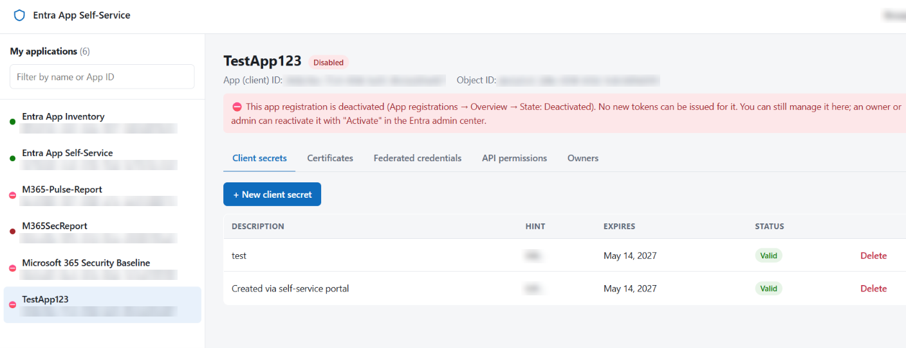
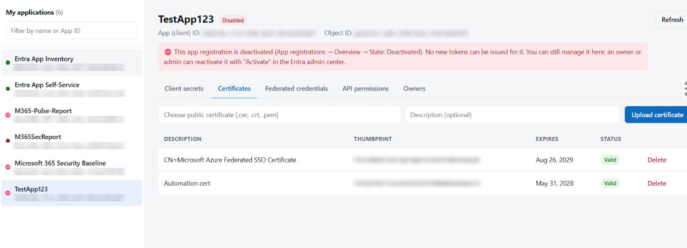
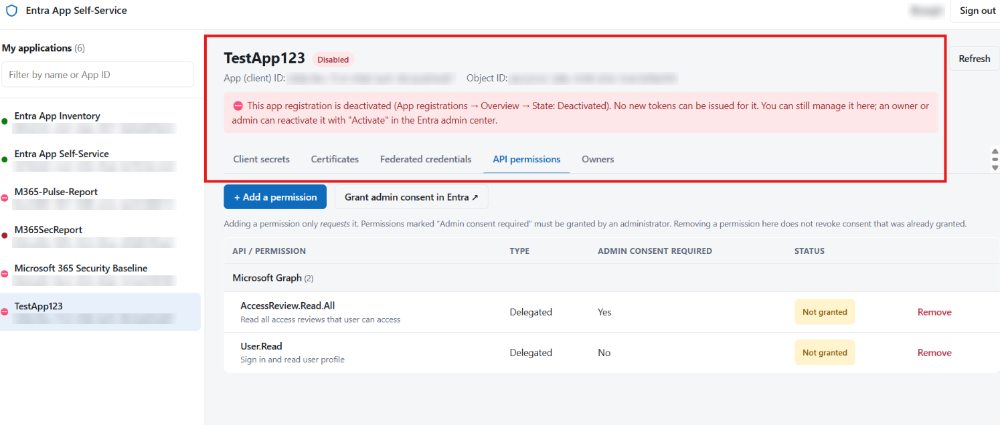
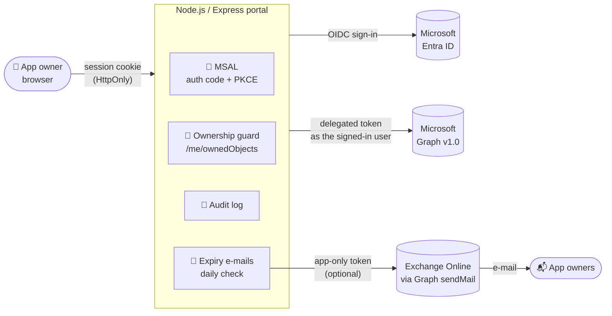
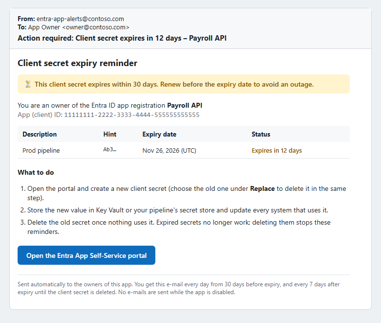
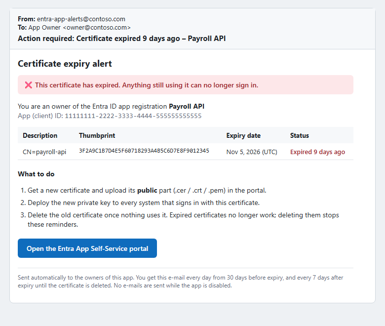

<a id="top"></a>
<div align="center">

# 🛡️ Entra App Self-Service Portal

**Free, self-hosted web portal where app owners sign in with Entra ID SSO and manage their own app registrations: secrets, certificates, federated credentials, API permissions and owners.**

[](https://nodejs.org)
[](https://learn.microsoft.com/entra/identity/)
[](https://learn.microsoft.com/graph/overview)
[](https://learn.microsoft.com/entra/identity-platform/msal-overview)
[](LICENSE)
[](https://github.com/21bshwjt/Entra-Apps-Management/stargazers)
[](https://github.com/21bshwjt/Entra-Apps-Management/network/members)
[](https://www.linkedin.com/in/bshwjt/)

[Quick Start](#quick-start) · [Screenshots](#screenshots) · [How It Works](#how-it-works) · [Configuration](#configuration) · [Troubleshooting](#troubleshooting) · [Report a Bug](https://github.com/21bshwjt/Entra-Apps-Management/issues/new)

</div>

---

## 💡 Why?

App owners usually have to raise a ticket every time a client secret expires or a pipeline needs a new federated credential. This portal lets owners do it themselves, safely:

- 🔑 Users sign in with **Entra ID SSO**.
- 👀 They see **only the app registrations they own**.
- 🧱 Everything runs **as the signed-in user** (delegated Graph permissions), so Entra itself enforces who can change what.
- 🧾 Every change is written to an **audit log**.

---

## ✨ Features

<table>
<tr>
<td width="50%" valign="top">

### 🔑 Client secrets
- Create a secret; the value is **shown once** with a copy button
- **Rotate in one step:** create a new secret and delete the old one
- Expiry from 1 to 24 months (cap configurable)
- 🟢 Valid · 🟡 Expiring (≤ 30 days) · 🔴 Expired

</td>
<td width="50%" valign="top">

### 📜 Certificates
- Upload a public `.cer` / `.crt` / `.pem`
- Validated on the server: **private keys, expired certificates and duplicates are rejected**
- Existing certificates are kept when a new one is added
- Thumbprint and expiry status shown

</td>
</tr>
<tr>
<td width="50%" valign="top">

### 🔗 Federated credentials
- Add, edit and delete workload identity federation credentials
- Presets: **GitHub Actions**, **Kubernetes**, **Azure DevOps**, any OIDC issuer
- **Live preview** of the issuer and subject before saving

</td>
<td width="50%" valign="top">

### 🧩 API permissions
- View requested permissions with **consent status**
- Add **Delegated** or **Application** permissions for any API in the tenant
- One-click link to the Entra **admin consent** page
- Owners *request*; admins *grant*

</td>
</tr>
<tr>
<td width="50%" valign="top">

### 👥 Owners
Search by name, UPN, email or object ID, then add or remove owners. **The last owner can't be removed**, and removing yourself asks for confirmation.

</td>
<td width="50%" valign="top">

### 📧 Expiry e-mails *(optional)*
- Owners get an e-mail **every day from 30 days before** a secret or certificate expires
- **Once a week** after it has expired, until it is deleted
- Separate e-mails for **client secrets** and **certificates**
- **No e-mail for disabled apps**; sent by the portal itself, no scheduler needed

</td>
</tr>
</table>

---

<a id="screenshots"></a>
## 📸 Screenshots

The left pane lists the apps you own, with a health dot (🟢 valid · 🟡 expiring · 🔴 expired) or ⛔ for a disabled app. The examples below show a **deactivated** app: it gets a red **Disabled** badge and a note explaining why, and can still be managed.

### 🔑 Client secrets
Create, rotate and delete secrets, with the expiry date and status of each.



### 📜 Certificates
Upload a public certificate (.cer / .crt / .pem) and see each certificate's thumbprint, expiry date and status.



### 🧩 API permissions
See requested permissions with their consent status, add new ones, and open the admin consent page in Entra.



<sub>App IDs, object IDs, thumbprints, secret hints and the signed-in user's name are blurred.</sub>

---

<a id="how-it-works"></a>
## 🏗️ How it works



| Layer | What protects you |
|---|---|
| **Entra ID** | Delegated permissions mean Graph applies the *user's* own rights, so a normal user can only change apps they own |
| **Portal** | Before every action, the server re-checks that the app is in `/me/ownedObjects`. Even admins only see their **own** apps here. |
| **Browser** | Never sees a token. It only holds an HttpOnly, SameSite session cookie. |

---

## 📋 Prerequisites

| | Requirement | Notes |
|---|---|---|
| 🟩 | **Node.js 20 or later** | [nodejs.org](https://nodejs.org). Check with `node -v`. Node 18 is end-of-life and no longer supported. |
| 🏢 | **An Entra ID tenant** | Any work or school tenant. A free [M365 developer tenant](https://developer.microsoft.com/microsoft-365/dev-program) works for testing. |
| 👑 | **An admin, once** | *Cloud Application Administrator*, *Privileged Role Administrator* or *Global Administrator*, to register the portal and grant consent |
| 🌿 | **Git** *(optional)* | Or download the ZIP from GitHub |

---

<a id="quick-start"></a>
## 🚀 Quick start

```bash
# 1️⃣  Get the code
git clone https://github.com/21bshwjt/Entra-Apps-Management.git
cd Entra-Apps-Management

# 2️⃣  Install dependencies
npm install

# 3️⃣  Register the portal in Entra ID (Step 1 below), then create your config
cp .env.example .env            # Windows PowerShell: Copy-Item .env.example .env
#     → fill in TENANT_ID, CLIENT_ID, CLIENT_SECRET, SESSION_SECRET (Step 2 below)

# 4️⃣  Start
npm start                       # 👉 http://localhost:3000
```

> [!TIP]
> Entra accepts `http://localhost` redirect URIs, so you can run everything locally **without HTTPS**.

---

## 🔐 Step 1 · Register the portal in Entra ID

<details open>
<summary><b>Option A: Entra admin center (click-through)</b></summary>

<br/>

1. **Entra admin center → App registrations → New registration**
   - **Name:** `Entra App Self-Service`
   - **Supported account types:** *Accounts in this organizational directory only*
   - **Redirect URI:** platform **Web** (⚠️ not SPA), value `http://localhost:3000/auth/callback`
2. **Overview:** copy the **Application (client) ID** and the **Directory (tenant) ID**.
3. **Certificates & secrets → New client secret.** Copy the **Value** (not the Secret ID).
4. **API permissions → Add a permission → Microsoft Graph → Delegated permissions:**

   | Permission | Why it's needed |
   |---|---|
   | `openid` · `profile` · `offline_access` | Sign-in and token refresh |
   | `User.Read` | Signed-in user's profile |
   | `User.ReadBasic.All` | Search users to add as owners |
   | `Application.ReadWrite.All` | Read and update apps the user owns (Entra still enforces ownership) |
   | `DelegatedPermissionGrant.Read.All` *(optional)* | Shows consent status for delegated permissions; without it, that status is "Unknown" |

5. Click **✅ Grant admin consent for &lt;tenant&gt;**.
6. *(Recommended)* **Enterprise applications → Entra App Self-Service → Properties → Assignment required = Yes**, then assign who may use the portal.

</details>

<details>
<summary><b>Option B: Azure CLI (scripted, run as an admin)</b></summary>

<br/>

```bash
APP_ID=$(az ad app create --display-name "Entra App Self-Service" \
  --sign-in-audience AzureADMyOrg \
  --web-redirect-uris http://localhost:3000/auth/callback \
  --query appId -o tsv)

GRAPH=00000003-0000-0000-c000-000000000000
for P in openid profile offline_access User.Read User.ReadBasic.All Application.ReadWrite.All DelegatedPermissionGrant.Read.All; do
  ID=$(az ad sp show --id $GRAPH --query "oauth2PermissionScopes[?value=='$P'].id" -o tsv)
  az ad app permission add --id $APP_ID --api $GRAPH --api-permissions $ID=Scope
done

az ad sp create --id $APP_ID
az ad app permission admin-consent --id $APP_ID
az ad app credential reset --id $APP_ID --display-name portal --years 1 --query password -o tsv  # → CLIENT_SECRET
echo "CLIENT_ID=$APP_ID"
az account show --query tenantId -o tsv                                                          # → TENANT_ID
```

</details>

---

<a id="configuration"></a>
## ⚙️ Step 2 · Configure `.env`

```bash
cp .env.example .env              # macOS / Linux / Git Bash
Copy-Item .env.example .env       # Windows PowerShell
```

| Variable | Required | Description |
|---|:---:|---|
| `TENANT_ID` | ✅ | Directory (tenant) ID |
| `CLIENT_ID` | ✅ | Application (client) ID of the portal |
| `CLIENT_SECRET` | ✅ | Client secret **Value** of the portal |
| `REDIRECT_URI` | ✅ | Must exactly match the **Web** redirect URI |
| `SESSION_SECRET` | ✅ | Long random string that signs the session cookie |
| `POST_LOGOUT_REDIRECT_URI` | | Where to land after sign-out |
| `PORT` | | Default `3000` |
| `MAX_SECRET_MONTHS` | | Longest lifetime for new client secrets (1–24, default 24) |
| `NOTIFY_ENABLED` | | `true` turns on expiry e-mails to owners (default `false`). See [Step 4](#notifications). |
| `NOTIFY_SENDER` | 📧 | Shared mailbox the e-mails are sent from. Required when `NOTIFY_ENABLED=true`. |
| `NOTIFY_DAYS_BEFORE` | | E-mail daily from this many days before expiry (default `30`) |
| `NOTIFY_EXPIRED_EVERY_DAYS` | | After expiry, e-mail every this many days until the credential is deleted (default `7`) |
| `NOTIFY_HOUR` | | Hour of the day (0–23, **server time**) when the daily check runs (default `8`) |
| `PORTAL_URL` | | Link in the e-mail. Leave empty to use the address from `REDIRECT_URI` (e.g. `http://localhost:3000`) |
| `NOTIFY_STATE_FILE` | | Where the "last e-mailed" record is kept (default `data/notify-state.json`) |
| `SESSION_MAX_HOURS` | 🔒 | Sessions end after this many hours even when active (1–24, default `8`) |
| `PRIVILEGED_APPS` | 🔒 | `block` *(default)*: no new credentials or owners on apps with high-risk permissions. `warn`: allow, but flag and log. |
| `PROTECTED_APP_IDS` | 🔒 | Extra app (client) IDs to always treat as privileged, comma separated |
| `FEDERATED_ALLOWED_ISSUERS` | 🔒 | Allowed federated credential issuers, comma separated. A `*` at the end matches the rest of the URL; elsewhere it matches one host label or path segment. `*` alone allows any `https` issuer. Empty = defaults: `https://token.actions.githubusercontent.com`, `https://vstoken.dev.azure.com/*`, `https://login.microsoftonline.com/<TENANT_ID>/v2.0`, `https://*.oic.prod-aks.azure.com/*` |
| `ALLOW_GUEST_OWNERS` | 🔒 | `true` lets guests (`#EXT#`) be added as owners (default `false`) |

🎲 Generate `SESSION_SECRET`:

```bash
node -e "console.log(require('crypto').randomBytes(48).toString('hex'))"
```

> [!IMPORTANT]
> Put real values in **`.env`**, not `.env.example`; the app only reads `.env`. `.env` is git-ignored, so **never commit it**.

---

## ▶️ Step 3 · Run

```bash
npm start          # production-style
npm run dev        # auto-restart on code changes
```

Open **http://localhost:3000** → **Sign in with Microsoft** 🎉

> [!NOTE]
> The server reads `.env` **only at startup**. Restart it (**Ctrl+C**, then `npm start`) after editing `.env`.
> After updating files in `public/`, hard-refresh the browser with **Ctrl+F5**.

<details>
<summary><b>🧪 Creating test data</b></summary>

<br/>

- **An app to manage:** create a throwaway app registration and add yourself under **Owners**. Only apps you own appear in the portal.
- **A test certificate** (upload only the public part):

  ```powershell
  # Windows
  $c = New-SelfSignedCertificate -Subject "CN=test-selfservice" -CertStoreLocation Cert:\CurrentUser\My -NotAfter (Get-Date).AddYears(1)
  Export-Certificate -Cert $c -FilePath .\test.cer
  ```

  ```bash
  # macOS / Linux: upload test.pem only
  openssl req -x509 -newkey rsa:2048 -nodes -keyout k.pem -out test.pem -days 365 -subj "/CN=test"
  ```

- **The non-owner path:** sign in as a user who owns nothing. The list should be empty.

</details>

---

<a id="notifications"></a>
## 📧 Step 4 · Expiry e-mails to owners *(optional)*

The portal can e-mail app owners about expiring and expired client secrets and certificates. **No scheduler is needed:** while the portal is running, it checks once a day by itself.

| Credential | E-mail | To |
|---|---|---|
| ⏳ Expires within **30 days** | **Every day** until it is renewed or deleted | Owners only |
| ❌ **Expired** | **Once a week** until it is deleted | Owners only |
| ⛔ App is **disabled** (deactivated, sign-in turned off, or disabled by Microsoft) | **None** | — |
| 👤 App has no enabled owner with a mailbox | **None** (logged) | — |

There are **two kinds of e-mail**, each with its own subject, table and "What to do" steps:

| E-mail | Example subject | Table shows |
|---|---|---|
| 🔑 **Client secret** | `Action required: Client secret expires in 12 days – Payroll API`<br>`Action required: Client secret expired 9 days ago – Payroll API` | Description, hint, expiry date, status |
| 📜 **Certificate** | `Action required: Certificate expires in 5 days – Payroll API`<br>`Action required: Certificate expired 9 days ago – Payroll API` | Description, thumbprint, expiry date, status |

When several are due on the same app, they share one e-mail, e.g. `Action required: 2 certificates expired or expiring – Payroll API`. An app gets **at most one secret e-mail and one certificate e-mail per day**. All owners are in **To**; there is no CC or BCC.

#### 📬 Sample e-mails

<table>
<tr>
<th width="50%">🔑 Client secret expiring <i>(sent daily)</i></th>
<th width="50%">📜 Certificate expired <i>(sent weekly)</i></th>
</tr>
<tr>
<td valign="top"></td>
<td valign="top"></td>
</tr>
</table>

<sub>Sample data only (Payroll API, contoso.com). Expiring credentials get a yellow ⏳ banner and expired ones a red ❌ banner. The table shows the secret's <b>hint</b> or the certificate's <b>thumbprint</b>, and the button links to <code>PORTAL_URL</code>.</sub>

### 4.1 · Create the sender mailbox

**Exchange admin center → Recipients → Mailboxes → Add a shared mailbox**, e.g. `entra-app-alerts@yourdomain.com`. A shared mailbox doesn't need a license.

### 4.2 · Give the portal application permissions

**Entra admin center → App registrations → Entra App Self-Service → API permissions → Add a permission → Microsoft Graph → Application permissions:**

| Permission | Why it's needed |
|---|---|
| `Application.Read.All` | Read every app's secrets, certificates, owners and disabled state |
| `User.Read.All` | Read owners' e-mail addresses and whether their accounts are enabled |

Then click **✅ Grant admin consent for &lt;tenant&gt;**.

> [!WARNING]
> **Do not add `Mail.Send` here.** In Entra it would let the portal send as *any* mailbox. Step 4.3 grants it for the shared mailbox only.

### 4.3 · Allow sending from the shared mailbox only (Exchange Online RBAC)

You need the portal's **Application (client) ID** and the **Object ID of its enterprise application** (*Enterprise applications → Entra App Self-Service → Overview*; this is **not** the object ID shown under App registrations).

```powershell
Install-Module ExchangeOnlineManagement   # once
Connect-ExchangeOnline

New-ServicePrincipal -AppId <portal-client-id> -ObjectId <enterprise-app-object-id> -DisplayName "Entra App Self-Service"

New-ManagementScope -Name "EntraPortalSender" `
  -RecipientRestrictionFilter "PrimarySmtpAddress -eq 'entra-app-alerts@yourdomain.com'"

New-ManagementRoleAssignment -App <portal-client-id> -Role "Application Mail.Send" `
  -CustomResourceScope "EntraPortalSender"

# Check: InScope must be True for the shared mailbox...
Test-ServicePrincipalAuthorization -Identity <portal-client-id> -Resource entra-app-alerts@yourdomain.com
# ...and False for any other mailbox
Test-ServicePrincipalAuthorization -Identity <portal-client-id> -Resource someone.else@yourdomain.com
```

> [!NOTE]
> Exchange can take **up to 2 hours** to apply a new role assignment. Until then, sending fails with `403`.

### 4.4 · Turn it on in `.env`

```ini
NOTIFY_ENABLED=true
NOTIFY_SENDER=entra-app-alerts@yourdomain.com
NOTIFY_DAYS_BEFORE=30
NOTIFY_EXPIRED_EVERY_DAYS=7
NOTIFY_HOUR=8
PORTAL_URL=
```

`PORTAL_URL` is the link in the e-mail. Leave it empty to use the address from `REDIRECT_URI` (`http://localhost:3000/auth/callback` → `http://localhost:3000`).

### 4.5 · Test, then restart

```bash
npm run notify:check       # 🔍 dry run: lists who WOULD get which e-mail; sends nothing
npm run notify:send-now    # 📤 sends today's e-mails now (never sends the same e-mail twice in a day)
```

Restart the portal (**Ctrl+C**, then `npm start`). The terminal shows:

```
[notify] Expiry e-mails on: daily from 30 days before expiry, every 7 days after expiry, checked from 08:00 server time, sent from entra-app-alerts@yourdomain.com.
```

After each daily check it prints a summary line, and every e-mail sent is written to the [audit log](#security) as `notify.sent`.

> [!IMPORTANT]
> - **The portal must keep running.** No e-mails are sent while it's stopped; the next check after it starts catches up on that day.
> - **Run one instance only.** Each instance would send its own copy of every e-mail.
> - `data/notify-state.json` records what was sent. Deleting it means today's e-mails may be sent again. It is git-ignored.

---

## 📖 Using the portal

The left pane lists your apps, with a health dot: 🟢 all credentials valid · 🟡 something expires within 30 days · 🔴 something has expired.

⛔ marks a **disabled** app. That means one of:

- the app registration is **deactivated** (*App registrations → Overview → State: Deactivated*; read from the Graph beta `isDisabled` property),
- sign-in is turned off on its enterprise app (*Enterprise applications → Properties → Enabled for users to sign-in? = No*), or
- Microsoft has disabled it.

A disabled app can't get new tokens, but you can still manage its credentials and owners here.

**Disable app (one way).** On an app's page, **Disable app** deactivates the app registration (Graph beta `isDisabled = true`) after a confirmation. It's meant for apps that are no longer needed or may be compromised. **The portal has no Enable option:** to bring the app back, ask an Entra administrator to select **Activate** on the app registration in the Entra admin center. Each disable is written to the audit log as `app.disable`.

<details>
<summary><b>🔑 Client secrets</b></summary>

<br/>

- **+ New client secret:** enter a description and choose an expiry. You can also choose an existing secret to **replace**; it is deleted right after the new one is created.
- The value is shown **once**. Store it in Key Vault or your pipeline's secret store before closing the dialog.
- **Delete** takes effect immediately.

</details>

<details>
<summary><b>📜 Certificates</b></summary>

<br/>

- Choose a `.cer`, `.crt` or `.pem` file containing the **public** certificate only, then click **Upload certificate**.
- ❌ Rejected: files containing a private key (PFX, or PEM with a key), expired certificates, duplicates, RSA keys under 2048 bits, and certificates signed with SHA-1 or MD5.

</details>

<details>
<summary><b>🔗 Federated credentials</b></summary>

<br/>

| Scenario | You enter | Issuer and subject generated |
|---|---|---|
|  | Org, repo, entity (environment / branch / tag / PR) | `https://token.actions.githubusercontent.com`<br>`repo:org/repo:environment:prod` |
|  | Cluster issuer URL, namespace, service account | `system:serviceaccount:<ns>:<sa>` |
|  | Org ID, org, project, service connection | `https://vstoken.dev.azure.com/<orgId>`<br>`sc://<org>/<project>/<connection>` |
| 🌐 Other | Issuer URL, subject | As entered |

- The audience defaults to `api://AzureADTokenExchange`.
- **Edit** changes the issuer, subject, audience and description. The **name can't be changed**.
- Limits: 20 per app, `https://` issuers only, no wildcards, no duplicates.
- 🔒 Only **allowed issuers** are accepted. The defaults are GitHub Actions, Azure DevOps, Entra ID (this tenant) and AKS. Other issuers (e.g. your own Kubernetes cluster) must be added to `FEDERATED_ALLOWED_ISSUERS` by the portal administrator.

</details>

<details>
<summary><b>🧩 API permissions</b></summary>

<br/>

| Status | Meaning |
|---|---|
| 🟢 **Granted for tenant** | Admin consent is in place |
| 🟡 **User consent only** | Some users consented; there's no tenant-wide grant |
| 🟡 **Not granted** | Requested, but not consented yet |
| ⚪ **Unknown** | The portal can't read delegated grants (add `DelegatedPermissionGrant.Read.All`) |

- **+ Add a permission:** choose an API (shortcuts for Microsoft Graph, Azure Service Management, SharePoint and Key Vault, or search), choose **Delegated** or **Application**, tick the permissions, then click **Add**.
- **Grant admin consent in Entra ↗:** opens the app's consent page for an administrator.

> [!CAUTION]
> Adding a permission only **requests** it. Removing a permission does **not** revoke consent already granted; an admin has to revoke it in Entra.

</details>

<details>
<summary><b>👥 Owners</b></summary>

<br/>

- **+ Add owner:** type at least 2 characters of a name, UPN or email, or paste a full UPN or object ID, then click the user.
- **Remove:** the last owner can't be removed. Removing **yourself** asks for confirmation, because you immediately lose access to the app.
- 🔒 Only **users** can be added; guests (`#EXT#`) are blocked unless `ALLOW_GUEST_OWNERS=true`.

</details>

<details>
<summary><b>⚠️ Apps with high-risk permissions</b></summary>

<br/>

An app is **privileged** when it has been *granted* a high-risk application permission, e.g. `Directory.ReadWrite.All`, `RoleManagement.ReadWrite.Directory`, `AppRoleAssignment.ReadWrite.All`, `User.ReadWrite.All`, `Mail.Send` or Exchange `full_access_as_app` (full list in [src/security.js](src/security.js)). Apps listed in `PROTECTED_APP_IDS` are privileged too.

Whoever adds a secret, certificate or federated credential to such an app can act with those permissions. So on privileged apps:

| `PRIVILEGED_APPS` | Add secret / certificate / federated credential / owner | Delete them |
|---|---|---|
| `block` *(default)* | ⛔ Blocked; the app page shows why. Ask an Entra administrator. | ✅ Allowed |
| `warn` | ✅ Allowed, but flagged in the UI and written to the security log | ✅ Allowed |

The **API permissions** tab and the **Add a permission** dialog also mark high-risk permissions with a red **High risk** badge, and every request for one is written to the security log.

</details>

---

<a id="troubleshooting"></a>
## 🧯 Troubleshooting

| Symptom | Fix |
|---|---|
| ❌ `Missing required environment variable …` | `.env` is missing or incomplete. Values go in `.env`, not `.env.example`. |
| ❌ `AADSTS700038 … 00000000-… is not a valid application identifier` | `CLIENT_ID` is still the placeholder. Fill in `.env`, **restart** the server, and open a new tab. |
| ❌ `AADSTS50011` redirect URI mismatch | Add a **Web** (not SPA) redirect URI exactly equal to `REDIRECT_URI`. |
| ❌ `AADSTS65001` consent required | Grant admin consent for the portal's permissions. |
| ❌ `AADSTS7000215` invalid client secret | You used the secret **ID** instead of its **Value**, or the secret expired. |
| ❌ `EADDRINUSE :::3000` | Another server is running. Press **Ctrl+C**, or end Node (Windows: `Get-Process node \| Stop-Process -Force`; macOS/Linux: `pkill node`), or change `PORT` and both URLs. |
| 🔄 New buttons or tabs don't appear | Cached files. Press **Ctrl+F5**. |
| 🔍 "Search failed: …" when adding an owner | Check that `User.ReadBasic.All` is consented, and look for `[4xx]` lines in the server terminal. |
| ⚪ Permission status "Unknown" | Add `DelegatedPermissionGrant.Read.All` (Delegated) and grant consent. |
| 🚫 "You are not an owner of this application" | Ask a current owner to add you. |
| ⏱️ "Session expired" | The 1-hour idle timeout or the `SESSION_MAX_HOURS` limit (default 8 hours) was reached, or the server restarted (sessions are in memory). Sign in again. |
| ⛔ "This app holds high-risk permissions … blocked" | The app has a high-risk permission granted. Ask an Entra administrator, or set `PRIVILEGED_APPS=warn` if your policy allows owners to manage such apps. |
| 🔗 "This issuer is not allowed" | Add the issuer to `FEDERATED_ALLOWED_ISSUERS` (comma separated, `*` wildcards allowed) and restart. |
| 👥 "Guest users cannot be added as owners" | Intended. Set `ALLOW_GUEST_OWNERS=true` to allow guests. |
| 📜 "The RSA key is 1024 bits …" / "signed with SHA-1" | Create a new certificate with an RSA 2048+ key and SHA-256. |
| 🚦 "Too many requests" (429) | The per-user limit was hit (600 requests per 5 minutes, 30 changes per minute). Wait and retry. |
| 🔢 `npm install` warns about the Node engine | Upgrade to Node.js 20 or later. |
| 📧 `[notify] Expiry e-mails are off` | Set `NOTIFY_ENABLED=true` in `.env` and restart. |
| 📧 `[notify] Run failed … Application.Read.All` | Add the Graph **Application** permissions from [Step 4.2](#notifications) and grant admin consent. |
| 📧 `Could not send e-mail … [403]` | The Exchange role assignment from [Step 4.3](#notifications) is missing, not applied yet (wait up to 2 hours), or `NOTIFY_SENDER` is a different mailbox. |
| 📧 An owner got no e-mail | Their account is disabled, they have no mailbox (`mail` is empty), or the app is disabled. Run `npm run notify:check` to see why. |

---

## ☁️ Deploying (e.g. Azure App Service)

- 🌐 Add `https://<host>/auth/callback` as a redirect URI and set `REDIRECT_URI` / `POST_LOGOUT_REDIRECT_URI` to match. Cookies become `Secure` automatically.
- 🧮 Sessions, the token cache and rate limits are **in memory**. Run **one instance**. More instances would need a shared store (e.g. Redis via `connect-redis`) and a distributed MSAL cache, which this project doesn't include.
- 🔢 Use the **Node 20 LTS** (or newer) runtime.

### 🔒 App Service hardening checklist

These are settings in Azure and Entra; none of them need code changes.

| # | Setting | Where |
|---|---|---|
| 1 | **HTTPS Only** = On, **Minimum TLS** = 1.2 | App Service → Configuration → General settings |
| 2 | **FTP** = Disabled, **SCM / FTP basic auth publishing** = Off, **Remote debugging** = Off | App Service → Configuration → General settings |
| 3 | **Secrets in Key Vault:** store `CLIENT_SECRET` and `SESSION_SECRET` in Key Vault and reference them as `@Microsoft.KeyVault(SecretUri=…)` with a **managed identity**. Better still, replace `CLIENT_SECRET` with a certificate or a managed identity federated credential. | Key Vault + App Service → Identity |
| 4 | **Access restrictions** on the app **and** the SCM (Kudu) site; ideally put **Front Door / Application Gateway with WAF** in front | App Service → Networking |
| 5 | **Assignment required** = Yes on the portal's enterprise app; assign only the people who need it | Entra → Enterprise applications → Properties |
| 6 | **Conditional Access** for the portal: require MFA (and a compliant device), and **block privileged admin roles** (e.g. Global / Application / Cloud Application Administrator) from using it | Entra → Conditional Access |
| 7 | **Diagnostic settings** sending App Service console logs to Log Analytics / Sentinel; alert on `"security":true` events | App Service → Diagnostic settings |
| 8 | **Microsoft Defender for App Service** = On | Defender for Cloud |
| 9 | Mark `NOTIFY_*` as **deployment slot settings**, and keep `NOTIFY_ENABLED=false` in staging slots | App Service → Configuration |
| 10 | Dependabot or `npm audit` in CI | GitHub → Settings → Code security |
- 📧 **Expiry e-mails on App Service:**
  - turn on **Always On**, or the daily check stops when the site goes idle;
  - set `NOTIFY_STATE_FILE=/home/data/notify-state.json` so the record survives restarts and redeploys;
  - App Service runs on **UTC**, so `NOTIFY_HOUR` is UTC unless you set `WEBSITE_TIME_ZONE`;
  - keep **one instance**, or each instance sends its own copy.

---

<a id="security"></a>
## 🛡️ Security

| Control | Implementation |
|---|---|
| 🔐 **Authentication** | Entra OIDC auth-code flow with PKCE and `state` check; session ID regenerated after login |
| ⏱️ **Sessions** | HttpOnly, SameSite=Lax cookie (`Secure` on HTTPS); 1-hour idle timeout **and** an absolute limit (`SESSION_MAX_HOURS`, default 8 hours); expired sessions are purged from memory |
| 🎟️ **Tokens** | Kept server-side in the MSAL cache, never sent to the browser. A user's tokens, including refresh tokens, are **removed from memory** when they sign out, after 1 hour idle, or at the absolute limit. |
| 🧱 **Authorization** | Delegated Graph permissions **plus** a server-side `/me/ownedObjects` check on every action |
| ⚠️ **Privileged apps** | New credentials and owners are **blocked** on apps granted high-risk permissions (`PRIVILEGED_APPS=block`), so an owner can't use the portal to take over a powerful app. See [Apps with high-risk permissions](#-using-the-portal). |
| 🛑 **CSRF** | Writes require `X-Requested-With: fetch` and a same-origin `Origin` (malformed or `null` origins are rejected). Sign-out is a same-origin POST. |
| 🚦 **Rate limits** | Per user: 600 API requests per 5 minutes and 30 changes per minute. Per IP: 60 sign-in requests per 5 minutes. |
| ✅ **Validation** | GUID-only IDs; names, URLs, subjects and lengths checked on the server; OData filter values escaped |
| 🔑 **Secrets** | Lifetime capped (≤ 24 months); value returned once, never stored or logged; the secret being replaced is checked **before** the new one is created |
| 📜 **Certificates** | Private keys, expired, duplicate and **weak** certificates (RSA < 2048 bits, SHA-1/MD5 signatures) rejected; existing certificates preserved |
| 🔗 **Federated** | `https` issuers from an **allowlist** only (`FEDERATED_ALLOWED_ISSUERS`); no credentials, query or fragment in the issuer; no wildcards; duplicates rejected; 20-per-app limit |
| 🧩 **Permissions** | Checked against the API's published scopes and roles; owners can only *request* them; **high-risk** permissions are badged and logged |
| 👥 **Owners** | Users only (no service principals); guests blocked by default; the last owner can't be removed; self-removal needs confirmation |
| 🧢 **Headers** | `helmet` (HSTS, nosniff and more), strict CSP (no inline script or style), `frame-ancestors 'none'`, `Cache-Control: no-store` on API and sign-in responses |
| 🧾 **Logging** | Every change → audit log; every denial → security log (see below) |
| 📦 **Dependencies** | `@azure/msal-node` 7.x, `npm audit` clean at release |
| 📧 **Expiry e-mails** | Optional. App-only *read* permissions only; `Mail.Send` is limited to one shared mailbox through Exchange RBAC. Sent to owners only. |

<details>
<summary><b>🧾 Audit log format</b></summary>

<br/>

Every change writes one JSON line to stdout:

```json
{"ts":"2026-11-13T10:15:02.123Z","audit":true,"user":"jane@contoso.com","userOid":"…","action":"secret.add","appId":"…","appName":"Payroll API","keyId":"…","months":6,"replaced":null}
```

**Actions:** `secret.add` · `secret.remove` · `certificate.add` · `certificate.remove` · `federated.add` · `federated.update` · `federated.remove` · `permission.add` · `permission.remove` · `owner.add` · `owner.remove` · `notify.sent` (user `system`)

</details>

<details>
<summary><b>🚨 Security log format</b></summary>

<br/>

Every denied or suspicious request writes one JSON line to stderr, with `"security":true`:

```json
{"ts":"2026-11-14T06:41:02.036Z","security":true,"event":"privileged_app_change_blocked","user":"jane@contoso.com","userOid":"…","ip":"203.0.113.7","method":"POST","path":"/api/apps/…/secrets","appId":"…","action":"secret.add","reasons":["Microsoft Graph: Directory.ReadWrite.All"]}
```

| Event | Meaning |
|---|---|
| `not_owner` | Tried to open or change an app the user doesn't own |
| `csrf_header_missing` · `bad_origin` · `signout_bad_origin` | Request didn't come from the portal's own page; possible CSRF |
| `rate_limited` | A user or IP hit a rate limit |
| `privileged_app_change_blocked` · `privileged_app_change_allowed` | Credential or owner change on a privileged app (blocked, or allowed in `warn` mode) |
| `privilege_check_failed` | The privileged-app check couldn't run, so the change was refused |
| `high_risk_permission_requested` | An owner requested a high-risk API permission |
| `federated_issuer_not_allowed` | A federated credential used an issuer outside the allowlist |
| `guest_owner_blocked` | Tried to add a guest as an owner |
| `session_max_lifetime_reached` | A session hit `SESSION_MAX_HOURS` |

💡 In Log Analytics, alert on `security == true`, especially `not_owner`, `privileged_app_change_*` and `high_risk_permission_requested`.

</details>

---

## 🔌 REST API reference

<details>
<summary><b>Show all endpoints</b></summary>

<br/>

All routes need a signed-in session. Routes under `/api/apps/:id` also require the caller to **own** the app. Write requests need the header `X-Requested-With: fetch`.

| Method | Route | Purpose |
|---|---|---|
| `GET` | `/auth/signin` · `/auth/callback` | Sign in |
| `POST` | `/auth/signout` | Sign out (same-origin only) |
| `GET` | `/api/me` | Current user |
| `GET` | `/api/apps` | Apps the user owns |
| `GET` | `/api/apps/:id` | App details, owners and federated credentials |
| `POST` | `/api/apps/:id/disable` | Deactivate the app `{reason?}`. One way: there is no enable route |
| `POST` | `/api/apps/:id/secrets` | Add a secret `{displayName, months, replaceKeyId?}` |
| `DELETE` | `/api/apps/:id/secrets/:keyId` | Delete a secret |
| `POST` | `/api/apps/:id/certificates` | Upload a certificate `{content (base64), displayName?}` |
| `DELETE` | `/api/apps/:id/certificates/:keyId` | Delete a certificate |
| `POST` | `/api/apps/:id/federated` | Add a federated credential `{name, issuer, subject, audience?, description?}` |
| `PATCH` | `/api/apps/:id/federated/:ficId` | Update a federated credential |
| `DELETE` | `/api/apps/:id/federated/:ficId` | Delete a federated credential |
| `GET` | `/api/apps/:id/permissions` | Requested permissions and consent status |
| `POST` | `/api/apps/:id/permissions` | Add permissions `{resourceAppId, permissions:[{id, type}]}` |
| `DELETE` | `/api/apps/:id/permissions/:resourceAppId/:type/:permId` | Remove a permission |
| `GET` | `/api/api-catalog?q=` | Search APIs |
| `GET` | `/api/api-catalog/:appId` | Scopes and roles an API offers |
| `POST` | `/api/apps/:id/owners` | Add an owner `{userId}` |
| `DELETE` | `/api/apps/:id/owners/:ownerId` | Remove an owner |
| `GET` | `/api/users?q=` | Search users |

</details>

---

## 📁 Project structure

```
📦 entra-apps-management
 ┣ 📂 src
 ┃ ┣ 📜 server.js      # Express app, session, security headers, error handler
 ┃ ┣ 📜 auth.js        # MSAL sign-in / callback / sign-out, token acquisition
 ┃ ┣ 📜 graph.js       # Microsoft Graph helpers
 ┃ ┣ 📜 api.js         # REST API, ownership guard, validation, audit log
 ┃ ┣ 📜 notify.js      # Expiry e-mails to owners (daily check inside the portal)
 ┃ ┗ 📜 security.js    # High-risk permission list, rate limits, issuer allowlist, certificate checks, security log
 ┣ 📂 data             # notify-state.json: what was e-mailed when (git-ignored)
 ┣ 📂 docs/images      # Portal screenshots and sample e-mails used in this README
 ┣ 📂 public
 ┃ ┣ 📜 index.html     # UI markup (tabs and dialogs)
 ┃ ┣ 📜 app.js         # UI logic
 ┃ ┗ 📜 styles.css     # Styles (light and dark mode)
 ┣ 📜 .env.example     # Config template → copy to .env
 ┣ 📜 .gitignore
 ┣ 📜 package.json
 ┣ 📜 package-lock.json
 ┣ 📜 CHANGELOG.md
 ┗ 📜 README.md
```

---

<div align="center">

Built with ❤️ using **Node.js**, **MSAL** and **Microsoft Graph**

⭐ If this saved you a ticket, give the repo a star!

[](https://www.linkedin.com/in/bshwjt/)

[⬆ Back to top](#top)

</div>
